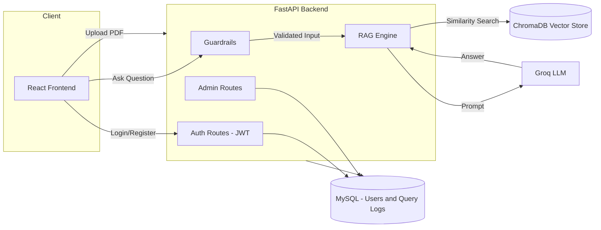

# DocMind — RAG Assistant with Role-Based Access Control

DocMind is a full-stack Retrieval-Augmented Generation (RAG) application that lets users upload PDF documents and ask natural-language questions about their contents. It combines a FastAPI backend, a Chroma vector store, and a Groq-hosted LLM for answer generation, wrapped in JWT authentication and a three-tier role-based access control (RBAC) system (`employee`, `manager`, `admin`). The system includes input/output guardrails, an admin monitoring dashboard, and Docker support for deployment.

## Features

- **Document Q&A (RAG)** — Upload PDFs, which are chunked, embedded with `sentence-transformers/all-MiniLM-L6-v2`, and stored in a Chroma vector database. Questions are answered using semantic similarity search combined with a Groq-hosted LLM (default `openai/gpt-oss-120b`, set with `GROQ_MODEL`).
- **JWT Authentication** — Email/password registration and login using `bcrypt` password hashing and signed JWTs (`python-jose`).
- **Role-Based Access Control** — Three roles with distinct permissions:
  | Role | Upload Docs | Delete Docs | Ask Questions | Manage Users | View Logs |
  |---|---|---|---|---|---|
  | Employee | ❌ | ❌ | ✅ | ❌ | ❌ |
  | Manager | ✅ | ❌ | ✅ | ❌ | ❌ |
  | Admin | ✅ | ✅ | ✅ | ✅ | ✅ |
- **Document-Level Access Control** — every document has an audience (*Everyone*, *Managers & Admins*, or *Admins only*) chosen at upload. The audience is stamped onto each chunk in the vector store and applied as a filter **inside the similarity search**, so text a user is not cleared for never reaches the LLM prompt — it cannot be leaked by clever prompting. The document list is filtered the same way, and admins can change a document's audience at any time without re-uploading.
- **Source Citations** — every answer shows where it came from. Retrieved excerpts are numbered in the prompt, the model cites them inline as `[1]`, `[2]`, and the API returns the cited sources (document, page number, excerpt). In the chat, each marker and source chip opens the exact excerpt, so answers can be verified at a glance. Sources pass through the same PII redaction as answers and can only come from documents the user's role may access.
- **Streaming Answers** — answers are written into the chat live, token by token, over Server-Sent Events (`/chat/stream`). Streaming does not weaken the guardrails: a streaming redactor holds back any text that could still be part of a card number, phone number or email and releases only text that is safe, so PII is never shown even for an instant. The final event carries the cited sources.
- **Guardrails**
  - **Input validation** — blocks overly long inputs and known prompt-injection patterns (e.g. "ignore previous instructions", "jailbreak", "DAN mode").
  - **Context-grounded answers** — the LLM is strictly prompted to answer only from retrieved document context, with a fixed fallback response when the answer isn't found.
  - **PII redaction** — responses are scanned for emails, phone numbers, Aadhaar numbers, PAN numbers, and credit card numbers, which are automatically redacted before being returned.
- **Admin Dashboard**
  - User management with inline role switching.
  - Live query log feed with guardrail violation flags.
  - Aggregate stats: total queries, average response time, guardrail violations, average chunks retrieved.
- **Modern Chat UI** — React single-page app with drag-and-drop PDF upload, live document indexing status, typing indicators, and a backend health indicator.
- **Containerized Frontend** — multi-stage Docker build (Node → Nginx) for production-ready static serving.

## Tech Stack

**Backend:** FastAPI, SQLAlchemy, MySQL, Pydantic, python-jose (JWT), bcrypt, LangChain, ChromaDB, HuggingFace `sentence-transformers`, Groq API (model configurable via `GROQ_MODEL`)

**Frontend:** React 18 (Create React App), Tabler Icons, DM Sans / DM Serif Display (Google Fonts)

**Infra:** Docker, Nginx

## System Architecture




## Project Structure

```
RAG_RBAC_Project/
├── app.py                  # FastAPI app & route definitions
├── access.py               # Document-level access rules (roles, chunk flags, search filter)
├── auth.py                 # Password hashing & JWT helpers
├── database.py              # SQLAlchemy engine/session setup
├── dependencies.py          # get_current_user / require_role guards
├── guardrails.py            # Input/output guardrails
├── ingest.py                 # PDF chunking & vector store ingestion
├── rag.py                   # Retrieval + Groq LLM answer generation
├── vector_store.py          # Shared embedding model + Chroma connection
├── models.py                # User & QueryLog ORM models
└── routes/
    └── auth_routes.py       # /auth/register, /auth/login

Frontend/
├── Dockerfile               # Multi-stage build (Node → Nginx)
├── nginx.conf
├── public/index.html
└── src/
    ├── App.jsx               # Root app, state & API orchestration
    ├── config.js             # Backend URL (REACT_APP_API_URL)
    └── components/
        ├── AuthScreen.jsx     # Login / Register
        ├── Sidebar.jsx        # Upload, docs list, admin tabs
        ├── ChatInput.jsx
        ├── Message.jsx
        ├── WelcomeScreen.jsx
        ├── UserPanel.jsx       # Admin: role management
        └── LogsPanel.jsx       # Admin: monitoring dashboard
```

## Getting Started

### Prerequisites

- Python 3.10+
- Node.js 18+
- MySQL server
- A running ChromaDB server (see [Docker](#docker) below)
- A [Groq API key](https://console.groq.com)

### Backend Setup

1. Install dependencies:
   ```bash
   pip install -r requirements.txt
   ```
2. Copy `.env.example` to `.env` in the project root and fill in your values:
   ```env
   SECRET_KEY=your-secret-key
   MYSQL_USER=root
   MYSQL_PASSWORD=yourpassword
   MYSQL_ROOT_PASSWORD=yourpassword
   MYSQL_HOST=localhost
   MYSQL_PORT=3306
   MYSQL_DB=rag_app
   CHROMA_HOST=localhost
   CHROMA_PORT=8001
   GROQ_API_KEY=your-groq-api-key
   GROQ_MODEL=openai/gpt-oss-120b
   ```
   `SECRET_KEY` is generated once (`python -c "import secrets; print(secrets.token_hex(32))"`) and does not expire; only login tokens do, after 24 hours. The backend refuses to start without it.
3. Start the API server:
   ```bash
   uvicorn app:app --reload
   ```
   The API will be available at `http://localhost:8000`.

### Frontend Setup

```bash
cd Frontend
npm install
npm start
```

The app runs at `http://localhost:3000` and expects the backend at `http://localhost:8000`. To point it elsewhere, set `REACT_APP_API_URL` (read in `src/config.js`).

### First Admin

The **first account registered becomes the admin**. Every later account starts as `employee` and can be promoted from the admin's Users tab.

### Docker

Run the whole stack (MySQL, ChromaDB, backend, frontend) with one command:

```bash
docker compose up --build
```

Compose sets the MySQL and ChromaDB hostnames for the backend container itself, so the same `.env` works for both Docker and local runs.

To run only ChromaDB in Docker while the backend runs locally with `uvicorn`:

```bash
docker run -d -p 8001:8000 -v chroma_data:/data --name chroma chromadb/chroma:1.5.9
```
---
## Screenshots

### Login page


### Employee page


### Manager page(Upload PDFs only)


### Admin page (Upload/Remove PDFs)
.png)

### Admin page (View the users)
.png)

### Admin page (Dashboard)
.png)

---
## API Reference

| Method | Endpoint | Access | Description |
|---|---|---|---|
| POST | `/auth/register` | Public | Register a new user (default role: `employee`) |
| POST | `/auth/login` | Public | Authenticate and receive a JWT |
| GET | `/auth/me` | Authenticated | Current user's profile and live role |
| GET | `/files` | Authenticated | List the documents the caller's role may access |
| POST | `/upload` | Manager, Admin | Upload & ingest a PDF with an `allowed_roles` audience (re-uploading replaces it) |
| DELETE | `/delete/{filename}` | Admin | Delete a document and its vectors |
| PATCH | `/documents/{filename}/access` | Admin | Change which roles can access a document |
| POST | `/chat` | Authenticated | Ask a question (RAG + guardrails); returns the answer plus its cited `sources`, using only documents the caller may access |
| POST | `/chat/stream` | Authenticated | Same as `/chat`, streamed as Server-Sent Events (`token` events, then one `done` event with the sources) |
| GET | `/admin/users` | Admin | List all users |
| PATCH | `/admin/users/{id}/role` | Admin | Update a user's role |
| GET | `/admin/logs` | Admin | Recent query logs |
| GET | `/admin/logs/stats` | Admin | Aggregate usage stats |

## Notable Design Decisions

- **Access control at retrieval, not at the prompt** — document permissions are enforced by a metadata filter in the vector search rather than by asking the LLM to withhold information. A manager also cannot upload a document their own role is locked out of, or overwrite an admins-only document by reusing its filename.
- **Redaction-safe streaming** — tokens are buffered up to a whitespace whose preceding word contains no digit or `@`. No PII pattern can span such a point, so redacting the released pieces one by one gives exactly the same result as redacting the whole answer.
- **Strict context grounding** — the LLM prompt explicitly forbids using outside knowledge and returns a fixed fallback message when no relevant context is retrieved, reducing hallucination.
- **Defense in depth** — guardrails run on both the input (length, prompt-injection regex checks) and the output (PII pattern redaction), independent of the LLM's own behavior.
- **Self-role-change protection** — admins are blocked from changing their own role via the API to prevent accidental lockout.
- **Observability by default** — every chat request, including guardrail-blocked ones, is logged with response time and chunk count for the admin dashboard.

## Future Improvements


- Add automated tests for guardrails and RBAC permission boundaries.

--- 
## Developed By

Karthik Aravind M
