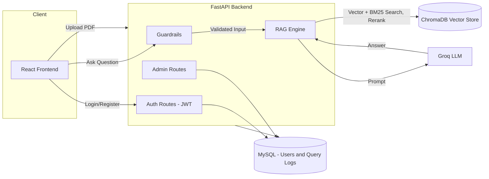
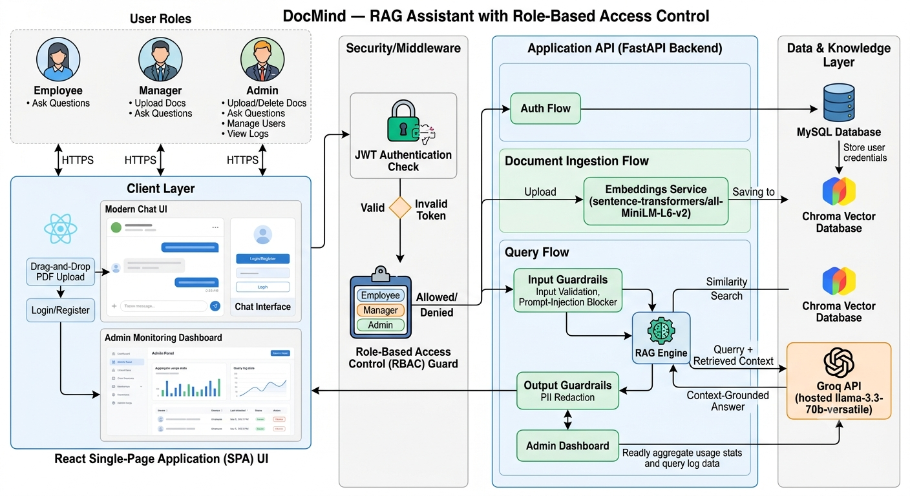
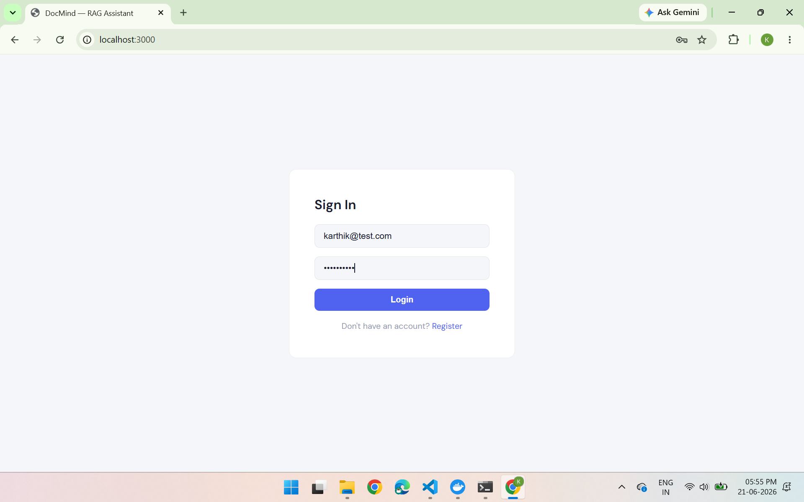
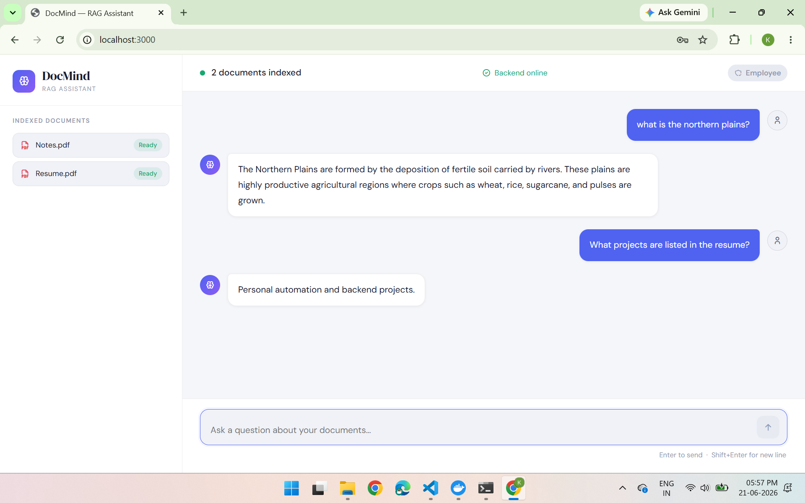
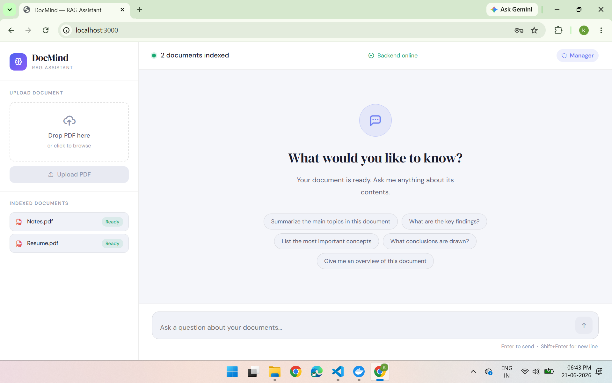

# DocMind — RAG Assistant with Role-Based Access Control

[](https://github.com/mkarthikaravind1/DocMind---RAG-Assistant/actions/workflows/ci.yml)

DocMind is a full-stack Retrieval-Augmented Generation (RAG) application that lets users upload PDF documents and ask natural-language questions about their contents. It combines a FastAPI backend, a Chroma vector store, and a Groq-hosted LLM for answer generation, wrapped in JWT authentication and a three-tier role-based access control (RBAC) system (`employee`, `manager`, `admin`). The system includes input/output guardrails, an admin monitoring dashboard, and Docker support for deployment.

## Features

- **Document Q&A (RAG)** — Upload PDFs, which are chunked, embedded with `sentence-transformers/all-MiniLM-L6-v2`, and stored in a Chroma vector database. Questions are answered using hybrid retrieval combined with a Groq-hosted LLM (default `openai/gpt-oss-120b`, set with `GROQ_MODEL`).
- **Hybrid Search with Reranking** — every question runs two searches side by side: vector similarity (finds text that *means* the same) and BM25 keyword search (finds the exact words, such as part codes, names and numbers, that embeddings are weak at). The two rankings are merged with Reciprocal Rank Fusion, then a cross-encoder (`cross-encoder/ms-marco-MiniLM-L-6-v2`, CPU) reads the question together with each candidate and picks the best three for the prompt. If the reranker is unavailable, retrieval falls back to the fused order instead of failing.
- **JWT Authentication with Refresh Tokens** — Email/password registration and login using `bcrypt` password hashing and signed JWTs (`python-jose`). The access token lasts 15 minutes and is kept in memory only. A 7-day refresh token in an `httpOnly` cookie renews it silently, is stored on the server only as a SHA-256 hash, and is rotated on every use: presenting a retired token revokes that whole sign-in. Signing out revokes the session on the server.
- **Role-Based Access Control** — Three roles with distinct permissions:
  | Role | Upload Docs | Delete Docs | Ask Questions | Manage Users | View Logs |
  |---|---|---|---|---|---|
  | Employee | ❌ | ❌ | ✅ | ❌ | ❌ |
  | Manager | ✅ | ❌ | ✅ | ❌ | ❌ |
  | Admin | ✅ | ✅ | ✅ | ✅ | ✅ |
- **Document-Level Access Control** — every document has an audience (*Everyone*, *Managers & Admins*, or *Admins only*) chosen at upload. The audience is stamped onto each chunk in the vector store and applied as a filter **inside both the vector search and the keyword search**, so text a user is not cleared for never reaches the LLM prompt — it cannot be leaked by clever prompting. The document list is filtered the same way, and admins can change a document's audience at any time without re-uploading.
- **Source Citations** — every answer shows where it came from. Retrieved excerpts are numbered in the prompt, the model cites them inline as `[1]`, `[2]`, and the API returns the cited sources (document, page number, excerpt). In the chat, each marker and source chip opens the exact excerpt, so answers can be verified at a glance. Sources pass through the same PII redaction as answers and can only come from documents the user's role may access.
- **Streaming Answers** — answers are written into the chat live, token by token, over Server-Sent Events (`/chat/stream`). Streaming does not weaken the guardrails: a streaming redactor holds back any text that could still be part of a card number, phone number or email and releases only text that is safe, so PII is never shown even for an instant. The final event carries the cited sources.
- **Conversation Memory & Chat History** — chats are saved per user and can be reopened, continued or deleted from the Chats tab; the current chat survives a page refresh. Follow-up questions ("from when does it start?") are rewritten into standalone questions using the recent turns before retrieval. History is used *only* for that rewrite: every answer is still built from freshly retrieved, access-filtered excerpts, so memory can never re-serve content from a document the user has since lost access to. Conversations are private to their owner, including from admins.
- **Answer Quality Evaluation** — every answered question is scored in the background on the two core RAGAS metrics, computed directly with the existing Groq model and embeddings (no extra dependency). **Faithfulness**: the answer is split into statements and each is checked against the retrieved excerpts, which exposes hallucination. **Answer relevancy**: the judge writes the questions the answer would answer, and their embedding similarity to the real question shows whether the answer drifted. The admin dashboard shows the averages, the number of low-faithfulness answers, the share of questions the documents could not answer, and both scores on every query. Scoring never delays or breaks a chat, and only numbers are stored.
- **Answer Feedback** — every answer has a thumbs up and a thumbs down. A thumbs down can carry one of four one-click reasons (wrong answer, missing information, wrong source, not relevant). Votes are saved with the conversation, can be changed or cleared, and only the owner of a conversation can vote on its answers. The admin dashboard shows the satisfaction rate, the share of answers rated, the reasons given, and each vote next to its query and quality scores, so a thumbs down can be compared with the faithfulness score of the same answer. No free text is collected, so feedback cannot carry PII or document content.
- **Audit Trail** — a permanent, admin-only record of who changed what: role changes (old and new role), document uploads and replacements (audience, chunk count), deletes, access changes (old and new audience) and new accounts, plus security events: sign-ins, failed sign-ins and permission-denied attempts. Failed and refused actions are recorded with a reason. A change and its audit row are saved in the same database transaction, the trail is insert-only with no API to edit or delete it, and it never holds document text, passwords or tokens. The admin Audit tab shows it as plain sentences with a filter by event type.
- **Rate Limiting** — an in-memory sliding-window limiter protects sign-in (per account and per address), registration, chat and uploads. A refused request gets `429` with a `Retry-After` header, never reaches the LLM, and the first refusal of each window is written to the audit trail. All limits are configurable.
- **Prompt-Injection Scanning of Uploads** — every PDF is scanned page by page before it is indexed, for text aimed at the model rather than the reader ("ignore all previous instructions", "reveal your system prompt", fake chat markup and similar). The text is normalised first, so spaced-out letters, zero-width characters, full-width look-alikes and phrases split across lines are still caught. A flagged PDF is refused with the page numbers; an admin can upload it anyway after a confirmation, and both outcomes are audited. The answer prompt also tells the model that excerpts are document text and never instructions.
- **Automated Tests & CI** — a pytest suite of about 255 tests runs the real application in-process and covers authentication, role boundaries, document-level access control, hybrid retrieval, answer evaluation, feedback, the audit trail, rate limits, refresh tokens, upload scanning, citations, streaming redaction and conversation memory. It needs no Docker, database server or API key, and GitHub Actions runs it (plus the frontend build) on every push and pull request.
- **Guardrails**
  - **Document scanning** — uploaded PDFs are checked for prompt-injection text before indexing.
  - **Input validation** — blocks overly long inputs and known prompt-injection patterns (e.g. "ignore previous instructions", "jailbreak", "DAN mode").
  - **Context-grounded answers** — the LLM is strictly prompted to answer only from retrieved document context, with a fixed fallback response when the answer isn't found.
  - **PII redaction** — responses are scanned for emails, phone numbers, Aadhaar numbers, PAN numbers, and credit card numbers, which are automatically redacted before being returned.
- **Admin Dashboard**
  - User management with inline role switching.
  - Live query log feed with guardrail violation flags.
  - Aggregate stats: total queries, average response time, guardrail violations, average chunks retrieved.
  - Answer quality: average faithfulness and answer relevancy, low-scoring answers, not-answered rate.
  - User feedback: satisfaction rate, share of answers rated, thumbs-down reasons.
  - Audit trail of administrative changes and security events.
- **Modern Chat UI** — React single-page app with drag-and-drop PDF upload, live document indexing status, typing indicators, and a backend health indicator.
- **Containerized Frontend** — multi-stage Docker build (Node → Nginx) for production-ready static serving.

## Tech Stack

**Backend:** FastAPI, SQLAlchemy, MySQL, Pydantic, python-jose (JWT), bcrypt, LangChain, ChromaDB, HuggingFace `sentence-transformers` (embeddings + cross-encoder reranker), BM25, Groq API (model configurable via `GROQ_MODEL`)

**Frontend:** React 18 (Create React App), Tabler Icons, DM Sans / DM Serif Display (Google Fonts)

**Infra:** Docker, Nginx

## System Architecture





## Project Structure

```
RAG_RBAC_Project/
├── app.py                  # FastAPI app & route definitions
├── access.py               # Document-level access rules (roles, chunk flags, search filter)
├── chat_history.py         # Saved conversations: ownership checks, history window, storage
├── audit.py                # Audit trail: insert-only record of changes and security events
├── auth.py                 # Password hashing & access-token (JWT) helpers
├── database.py              # SQLAlchemy engine/session setup
├── evaluation.py            # Answer quality scores: faithfulness and answer relevancy (background)
├── dependencies.py          # get_current_user / require_role guards
├── feedback.py              # Answer feedback: thumbs up/down storage and its link to the query log
├── guardrails.py            # Input/output guardrails, document injection scan
├── ingest.py                 # PDF scanning, chunking & vector store ingestion
├── ratelimit.py             # In-memory sliding-window rate limiter
├── tokens.py                # Refresh tokens: hashing, rotation, reuse detection, cookie
├── rag.py                   # Prompt building, Groq LLM answer generation, citations
├── retrieval.py             # Hybrid search: vector + BM25, rank fusion, cross-encoder reranking
├── vector_store.py          # Shared embedding model + Chroma connection
├── models.py                # ORM models (users, documents, conversations, query logs, evaluations, feedback, audit log, refresh tokens)
└── routes/
    ├── audit_routes.py      # /admin/audit (read-only)
    ├── auth_routes.py       # /auth/register, /auth/login, /auth/refresh, /auth/logout, /auth/me
    ├── conversation_routes.py  # /conversations (list, open, delete)
    ├── eval_routes.py       # /admin/evals (quality scores and their stats)
    └── feedback_routes.py   # /messages/{id}/feedback and /admin/feedback
tests/                      # pytest suite (see Testing below)
.github/workflows/ci.yml    # GitHub Actions: backend tests + frontend build

Frontend/
├── Dockerfile               # Multi-stage build (Node → Nginx)
├── nginx.conf
├── public/index.html
└── src/
    ├── App.jsx               # Root app, state & API orchestration
    ├── api.js                # apiFetch: access token in memory, silent refresh on 401
    ├── config.js             # Backend URL (REACT_APP_API_URL)
    └── components/
        ├── AuthScreen.jsx     # Login / Register
        ├── Sidebar.jsx        # Upload, docs list, admin tabs
        ├── ChatInput.jsx
        ├── Message.jsx         # Chat bubble: citations, sources, thumbs up/down
        ├── WelcomeScreen.jsx
        ├── ChatsPanel.jsx      # Saved conversations
        ├── UserPanel.jsx       # Admin: role management
        ├── AuditPanel.jsx      # Admin: audit trail
        └── LogsPanel.jsx       # Admin: monitoring dashboard, answer quality, user feedback
```

## Getting Started

### Prerequisites

- Python 3.10+
- Node.js 18+
- MySQL server
- A running ChromaDB server (see [Docker](#docker) below)
- A [Groq API key](https://console.groq.com)

### Backend Setup

1. Install dependencies:
   ```bash
   pip install -r requirements.txt
   ```
2. Copy `.env.example` to `.env` in the project root and fill in your values:
   ```env
   SECRET_KEY=your-secret-key
   MYSQL_USER=root
   MYSQL_PASSWORD=yourpassword
   MYSQL_ROOT_PASSWORD=yourpassword
   MYSQL_HOST=localhost
   MYSQL_PORT=3306
   MYSQL_DB=rag_app
   CHROMA_HOST=localhost
   CHROMA_PORT=8001
   GROQ_API_KEY=your-groq-api-key
   GROQ_MODEL=openai/gpt-oss-120b
   ```
   Optional: `RERANK_ENABLED=0` turns the cross-encoder reranker off, and `RERANKER_MODEL` picks a different one.
   `EVAL_SAMPLE_RATE` sets the share of answers that are quality-scored (`1` = all, `0.25` = one in four, `0` = off; each one costs three extra LLM calls), and `EVAL_MODEL` picks a different judge model.

   `SECRET_KEY` is generated once (`python -c "import secrets; print(secrets.token_hex(32))"`) and does not expire; only the tokens signed with it do. The backend refuses to start without it.

   Optional security settings (defaults in brackets): `ACCESS_TOKEN_EXPIRE_MINUTES` (15), `REFRESH_TOKEN_EXPIRE_DAYS` (7), `COOKIE_SECURE` (0; **set to 1 when serving over HTTPS**), `COOKIE_SAMESITE` (lax), and the rate limits as `count/seconds`: `RATE_LIMIT_LOGIN` (5/300), `RATE_LIMIT_LOGIN_IP` (30/300), `RATE_LIMIT_REGISTER` (5/3600), `RATE_LIMIT_CHAT` (20/60), `RATE_LIMIT_UPLOAD` (10/600). `RATE_LIMIT_ENABLED=0` switches them off.
3. Start the API server:
   ```bash
   uvicorn app:app --reload
   ```
   The API will be available at `http://localhost:8000`.

### Frontend Setup

```bash
cd Frontend
npm install
npm start
```

The app runs at `http://localhost:3000` and expects the backend at `http://localhost:8000`. To point it elsewhere, set `REACT_APP_API_URL` (read in `src/config.js`).

### First Admin

The **first account registered becomes the admin**. Every later account starts as `employee` and can be promoted from the admin's Users tab.

### Docker

Run the whole stack (MySQL, ChromaDB, backend, frontend) with one command:

```bash
docker compose up --build
```

Compose sets the MySQL and ChromaDB hostnames for the backend container itself, so the same `.env` works for both Docker and local runs.

To run only ChromaDB in Docker while the backend runs locally with `uvicorn`:

```bash
docker run -d -p 8001:8000 -v chroma_data:/data --name chroma chromadb/chroma:1.5.9
```

## Testing

```bash
pip install -r requirements-dev.txt
pytest
```

The suite starts the real FastAPI application in-process and replaces only what is external to it:

| Production | In tests |
|---|---|
| MySQL | a temporary SQLite file (`DATABASE_URL`) |
| ChromaDB server | an in-memory Chroma client |
| MiniLM embedding model | a deterministic keyword-hashing stand-in |
| Groq LLM | a rule-based stand-in that records every prompt it receives |
| Cross-encoder reranker | a word-overlap stand-in that records every passage it is given |
| Judge LLM (quality scores) | the same stand-in LLM, with judge prompts recorded separately |
| Background evaluation worker | run inline, so a test sees the scores immediately |

BM25 keyword search is plain Python and runs for real.

Because the stand-in LLM and reranker record what they are given, the tests can assert something a black-box test
cannot: that text from a restricted document was **never sent to either model at all**, not merely absent from the answer.

| File | What it covers |
|---|---|
| `tests/test_guardrails.py` | Prompt-injection patterns, PII redaction, and the streaming redactor checked against thousands of random token splits |
| `tests/test_access.py` | Document access rules |
| `tests/test_auth.py` | Registration, login, forged and expired tokens, role management |
| `tests/test_documents.py` | Upload and delete permissions, path traversal, re-upload, audiences, access changes |
| `tests/test_chat.py` | Answers, citations, redaction, access-filtered retrieval, streaming |
| `tests/test_retrieval.py` | BM25 keyword search, rank fusion, reranking and its failure fallback, role filtering of every search |
| `tests/test_evaluation.py` | Faithfulness and relevancy scoring, judge-output parsing, sampling, judge failures, and that the judge and the admin see no restricted, private or PII text |
| `tests/test_security.py` | Rate limits with a fake clock, account lock-out, refresh-token rotation, reuse detection, expiry and sign-out, cookie flags, and the PDF injection scan with its formatting tricks and admin override |
| `tests/test_audit.py` | Every audited event with its old and new values, failed and refused actions, denials, filters and paging, and that the trail holds no secrets and cannot be changed through the API |
| `tests/test_feedback.py` | Voting, switching and clearing, reasons, ownership, admin stats, votes after a conversation is deleted |
| `tests/test_conversations.py` | Follow-up rewriting, saved history, privacy, memory after access is revoked |
| `tests/test_monitoring.py` | Query logs, stats, CORS |

The stand-ins make the suite fast and repeatable, but they do not judge the quality of a real model's answers; that
still needs a run against the live stack.
---
## Screenshots

### Login page


### Employee page


### Manager page(Upload PDFs only)


### Admin page (Upload/Remove PDFs)
.png)

### Admin page (View the users)
.png)

### Admin page (Dashboard)
.png)

---
## API Reference

| Method | Endpoint | Access | Description |
|---|---|---|---|
| POST | `/auth/register` | Public | Register a new user (default role: `employee`) |
| POST | `/auth/login` | Public | Authenticate; returns a 15-minute access token and sets the refresh cookie |
| POST | `/auth/refresh` | Refresh cookie | Exchange the refresh cookie for a new access token (rotates the cookie) |
| POST | `/auth/logout` | Refresh cookie | Revoke the session on the server and clear the cookie |
| GET | `/auth/me` | Authenticated | Current user's profile and live role |
| GET | `/files` | Authenticated | List the documents the caller's role may access |
| POST | `/upload` | Manager, Admin | Upload & ingest a PDF with an `allowed_roles` audience (re-uploading replaces it). Refused with `422` if the injection scan flags it; an admin may send `allow_flagged=true` |
| DELETE | `/delete/{filename}` | Admin | Delete a document and its vectors |
| PATCH | `/documents/{filename}/access` | Admin | Change which roles can access a document |
| POST | `/chat` | Authenticated | Ask a question (RAG + guardrails), optionally continuing a `conversation_id`; returns the answer plus its cited `sources` and a `message_id`, using only documents the caller may access |
| POST | `/chat/stream` | Authenticated | Same as `/chat`, streamed as Server-Sent Events (`token` events, then one `done` event with the sources) |
| GET | `/conversations` | Authenticated | List the caller's saved conversations |
| GET | `/conversations/{id}` | Owner | Messages of one conversation, with their sources and the owner's votes |
| DELETE | `/conversations/{id}` | Owner | Delete a conversation |
| PUT | `/messages/{id}/feedback` | Owner | Rate an answer: `rating` is `up`, `down` or `null` (clear); `reason` is optional with `down` |
| GET | `/admin/users` | Admin | List all users |
| PATCH | `/admin/users/{id}/role` | Admin | Update a user's role |
| GET | `/admin/audit` | Admin | Audit trail, newest first; filter with `action`, `actor`, `outcome`; page with `limit` and `before` |
| GET | `/admin/logs` | Admin | Recent query logs, each with its quality scores when evaluated |
| GET | `/admin/logs/stats` | Admin | Aggregate usage stats |
| GET | `/admin/evals` | Admin | Recent answer quality evaluations (scores only, no answer or document text) |
| GET | `/admin/feedback` | Admin | Recent votes with the question and its quality scores (no answer text) |
| GET | `/admin/feedback/stats` | Admin | Thumbs up/down counts, satisfaction rate, share of answers rated, reasons |
| GET | `/admin/evals/stats` | Admin | Average faithfulness and answer relevancy, low-score count, not-answered rate |

## Notable Design Decisions

- **Access control at retrieval, not at the prompt** — document permissions are enforced by a metadata filter in the vector search and the keyword search rather than by asking the LLM to withhold information. A manager also cannot upload a document their own role is locked out of, or overwrite an admins-only document by reusing its filename.
- **Keyword search that cannot go stale** — BM25 caches only the tokenised text of each chunk, which never changes. The list of chunks a role may read is asked from Chroma on every question, so revoking access or deleting a document takes effect on the very next question. The reranker only sees the union of the two role-filtered searches.
- **No relevance cut-off** — a broad request such as "summarize this document" matches nothing strongly, so the best candidates always go to the model and the strict prompt decides whether they answer the question.
- **Evaluation that cannot leak or interfere** — scoring runs on a background worker after the response is sent, and every failure is swallowed. The judge is given only the excerpts the asker's role retrieved, with PII redacted. The scores live in their own table and are numbers only: the answer, the excerpts and the judge's output are never stored, so conversations stay private from admins. Fallback answers are counted as *not answered* rather than scored, and blocked questions are never evaluated.
- **Feedback without new data to protect** — a vote is a rating plus a preset reason, stored in its own table and linked to the query log when the answer is saved. Rating someone else's answer returns the same 404 as a message that does not exist. When a conversation is deleted its votes stay as statistics but are detached from the deleted messages, so a vote can never end up on a different answer.
- **Redaction-safe streaming** — tokens are buffered up to a whitespace whose preceding word contains no digit or `@`. No PII pattern can span such a point, so redacting the released pieces one by one gives exactly the same result as redacting the whole answer.
- **Memory that respects permissions** — conversation history never enters the answer prompt. It is only used to turn a follow-up into a standalone question; a blocked or failed question is never saved, and a first question only creates a conversation once it has been answered.
- **Strict context grounding** — the LLM prompt explicitly forbids using outside knowledge and returns a fixed fallback message when no relevant context is retrieved, reducing hallucination.
- **Short-lived access, revocable sessions** — a stolen access token dies within 15 minutes, and the long-lived refresh token sits in an `httpOnly` cookie scoped to `/auth` that page scripts cannot read. Rotation with reuse detection means a copied refresh token is noticed the moment both parties use it. Two tabs refreshing together within 10 seconds are treated as a race, not as theft. The cookie endpoints also reject requests whose `Origin` is not the configured frontend.
- **Lock-out that cannot be used as an oracle** — sign-in failures are counted per account, and while an account is locked even the correct password is refused, so the lock tells an attacker nothing. Counting per account rather than per address matters in Docker, where every browser reaches the backend from the same gateway address.
- **Scan before replace** — an upload is written under a temporary name and scanned before it replaces anything, so a refused PDF can never damage the document it would have overwritten.
- **Defense in depth** — guardrails run on both the input (length, prompt-injection regex checks) and the output (PII pattern redaction), independent of the LLM's own behavior.
- **Self-role-change protection** — admins are blocked from changing their own role via the API to prevent accidental lockout.
- **Observability by default** — every chat request, including guardrail-blocked ones, is logged with response time and chunk count for the admin dashboard.
- **An audit trail that cannot drift from reality** — the audit row is added to the same transaction as the change it describes, so neither can be saved without the other. Events that change nothing (sign-ins, denials, failures) are written separately and can never turn a refused request into a server error. A failed sign-in records whether the account was unknown or the password wrong, while the response to the caller stays identical for both.

## Future Improvements


--- 
## Developed By

Karthik Aravind M
